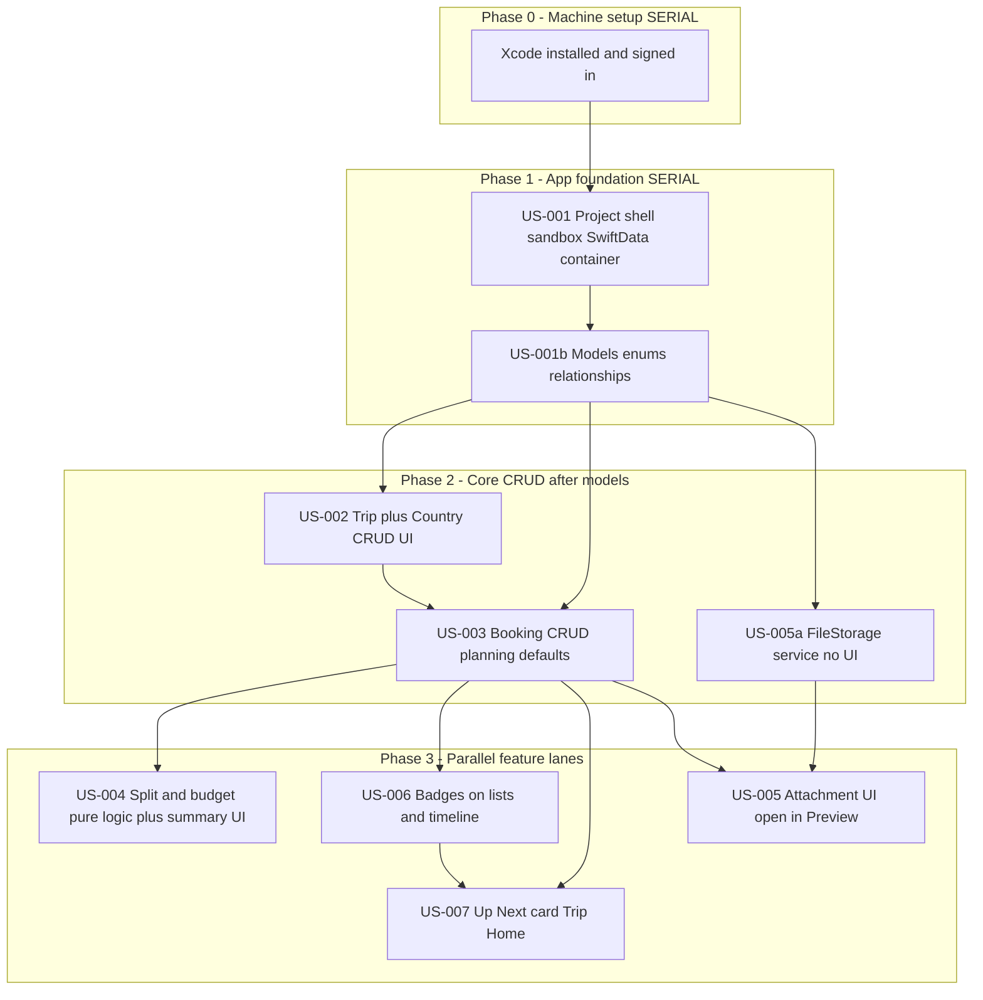

# PRD: TravelEasy (MVP)

## Introduction / Overview

TravelEasy is a local-only macOS app for managing a multi-country trip: bookings and activities per country, timelines (including flight times), confirmation documents, and itemized payments with a simple 50/50 split.

The primary user books most of the trip and needs one place to see what is booked vs still planned, what is paid vs pay-later, what their partner owes from paid items, and what is coming up next — without spreadsheets or cloud sync.

## Goals

- Keep flight, hotel, activity, and transport bookings organized under Trip → Country
- Persist all data and attached files across app relaunches on one Mac
- Support planning (unconfirmed items, optional estimates) without forcing payment details
- Show committed vs projected budget and trip date span so what-if legs are visible
- Compute a running 50/50 balance from paid items only
- Surface “Up Next” (travel, stays, activity) on the home screen
- Flag unbooked or pay-later items with a red top-right attention badge
- Open confirmation files in macOS Preview (no in-app preview)

## Delivery / Dependencies

Finish **Phase 0 → 1** on a single track. From **Phase 2** onward, work can split by lane. Do not start a story until its dependencies are done.

### Phase 0 — Machine setup (serial, human)

- Xcode 26.5 — done (`xcodebuild -version`)
- Apple ID signed in under Xcode → Settings → Accounts
- App must run once locally after Phase 1 exists

Not parallelizable with work that needs a compile.

### Phase 1 — App foundation (serial, one track)

| ID | Task | Layer | Notes |
|----|------|-------|-------|
| **US-001** | macOS SwiftUI app, bundle id, sandbox, entitlements, empty `NavigationSplitView` shell | Foundation | Produces the `.xcodeproj` |
| **US-001b** | SwiftData models: `Trip`, `Country`, `Booking`, `Attachment` + enums | Data | Same session/PR as US-001 is fine |

**Rule:** No feature UI merges before US-001b lands.

### Phase 2 — Core product surface

| ID | Task | Layer | Depends on | Parallel? |
|----|------|-------|------------|-----------|
| **US-002** | Trip bootstrap + Country CRUD | UI + data | US-001b | Start first |
| **US-003** | Booking CRUD (planning defaults) | UI + data | US-002 | After countries |
| **US-005a** | `FileStorage` helper (no UI) | Services | US-001b | **Yes — parallel with US-002/US-003** |

### Phase 3 — Feature lanes (parallel after US-003)

| Lane | ID | Task | Depends on |
|------|----|------|------------|
| Money | **US-004** | Split + committed/projected budget + trip date span | US-003 |
| Files | **US-005** | Attachment UI (open in Preview) | US-003 + US-005a |
| Focus | **US-006** → **US-007** | Attention badges, then Up Next card | US-003; badges before Up Next in this lane |

**Parallel tracks (2–3 people/agents):** A = US-004, B = US-005, C = US-006 → US-007.

**Solo order:** US-006 → US-004 → US-007 → US-005 (or files earlier if receipts matter sooner).

## User Stories

### US-001: App foundation and data schema

**Description:** As a developer, I need a runnable macOS SwiftUI + SwiftData project with the TravelEasy domain model so all features have a persistence base.

**Acceptance Criteria:**

- [ ] macOS App project named TravelEasy, bundle id `com.timrodz.traveleasy`
- [ ] SwiftUI lifecycle with `NavigationSplitView` shell (sidebar + detail placeholders)
- [ ] App Sandbox enabled; user-selected file read entitlement for imports
- [ ] SwiftData models: `Trip`, `Country`, `Booking`, `Attachment` with relationships Trip → Countries → Bookings → Attachments
- [ ] Enums persisted: booking `type` (`flight|hotel|activity|transport`), `confirmationStatus` (`planned|booked`), `paymentStatus` (`unset|paid|payLater`), `paidBy` (`personA|personB|splitAlready`)
- [ ] Booking fields: title, optional startAt/endAt, optional amount (Decimal), notes; defaults `planned` + `unset`
- [ ] Trip fields: name, homeCurrency (default `NZD`), personAName (`Me`), personBName (`Partner`)
- [ ] App launches without crash; empty store creates cleanly
- [ ] Typecheck / build succeeds in Xcode

### US-002: Trip shell and country CRUD

**Description:** As a traveler, I want one trip with countries I can add and manage so bookings have a place to live (including a draft extra country for planning).

**Acceptance Criteria:**

- [ ] On first launch, create a default Trip if none exists
- [ ] Sidebar lists countries for the trip; user can add, rename, reorder (or sort by sortOrder), and delete a country
- [ ] Deleting a country deletes or blocks deletion when it has bookings (choose cascade delete; document in UI)
- [ ] Trip settings editable: trip name, home currency, person A/B display names
- [ ] Data survives quit and relaunch
- [ ] Typecheck / build succeeds
- [ ] Verify in the Mac app (run TravelEasy from Xcode)

### US-003: Booking CRUD with planning defaults

**Description:** As a traveler, I want to add flights, hotels, activities, and transport under a country — including planned items without payment — so I can book and what-if in one list.

**Acceptance Criteria:**

- [ ] Create / edit / delete bookings under a selected country
- [ ] Type picker: Flight, Hotel, Activity, Transport
- [ ] New booking defaults to `confirmationStatus = planned`, `paymentStatus = unset`, amount empty
- [ ] User can set optional amount, dates/times (startAt/endAt), notes
- [ ] User can change confirmation to `booked` and payment to `paid` / `payLater` / `unset`
- [ ] When payment is `paid`, user must choose paidBy (person A, person B, or already split)
- [ ] List shows type, title, dates, confirmation, payment at a glance
- [ ] Data survives quit and relaunch
- [ ] Typecheck / build succeeds
- [ ] Verify in the Mac app

### US-004: Split summary, budget, and trip date span

**Description:** As the person managing payments, I want to see what each person paid, who owes whom (50/50), and committed vs projected budget plus trip dates so planning and settling stay clear.

**Acceptance Criteria:**

- [ ] Pure logic (testable) computes:
  - Split: only `paymentStatus == paid` rows with an amount; each person’s share is amount/2; net owed between person A and B
  - Committed budget: sum of amounts on `booked` items
  - Projected budget: committed + amounts on `planned` items
  - Trip date span: min startAt … max endAt across bookings that have dates (planned included)
- [ ] Summary UI on Trip Home (or dedicated summary section) shows the above in home currency
- [ ] Planned / unpaid items do not affect the 50/50 owe figure until marked `paid`
- [ ] Adding a planned booking with amount and dates updates projected budget and date span after save
- [ ] Typecheck / build succeeds
- [ ] Verify in the Mac app

### US-005: File attachments (storage + UI)

**Description:** As a traveler, I want to attach booking confirmations and open them in Preview so documents stay with the booking without building an in-app viewer.

**Acceptance Criteria:**

- [ ] `FileStorage` service copies picked files into Application Support under a stable relative path; can delete and resolve file URLs (US-005a; can ship before UI)
- [ ] On booking detail: add attachment(s) via file picker
- [ ] List attachments by original filename
- [ ] Double-click / Open action uses `NSWorkspace` to open in Preview (or default app)
- [ ] Remove attachment deletes store file and model row
- [ ] Attachments survive quit and relaunch and still open
- [ ] Typecheck / build succeeds
- [ ] Verify in the Mac app

### US-006: Attention badges on lists and timeline

**Description:** As a traveler, I want unbooked or pay-later items marked with a red top-right corner badge so I can spot gaps quickly.

**Acceptance Criteria:**

- [ ] Reusable badge view: red mark in the top-right corner of the booking row/card
- [ ] Badge shows when `confirmationStatus == planned` OR `paymentStatus == payLater`
- [ ] Badge hidden when booked and not pay-later
- [ ] Applied on country booking lists and any timeline list
- [ ] Typecheck / build succeeds
- [ ] Verify in the Mac app

### US-007: Trip Home “Up Next” card

**Description:** As a traveler, I want a home card showing what is coming up next so we stay focused without scanning every country.

**Acceptance Criteria:**

- [ ] Trip Home is the default detail landing view
- [ ] “Up Next” card shows (omit row if not applicable):
  1. Next travel — soonest future `flight` or `transport` by startAt
  2. Current accommodation — `hotel` where startAt ≤ now ≤ endAt
  3. Next accommodation — soonest future `hotel` with startAt > now
  4. Next activity — soonest future `activity` by startAt
- [ ] Each row shows title, country name, date/time
- [ ] Rows use the attention badge rules from US-006
- [ ] Empty state when no dated bookings exist
- [ ] Typecheck / build succeeds
- [ ] Verify in the Mac app

## Functional Requirements

- FR-1: The system must support exactly one active trip in MVP (auto-create on first launch).
- FR-2: The system must allow CRUD for countries under the trip.
- FR-3: The system must allow CRUD for bookings under a country with types flight, hotel, activity, transport.
- FR-4: New bookings must default to planned confirmation and unset payment; amount is optional.
- FR-5: The system must allow marking a booking as booked and setting payment to paid, payLater, or unset.
- FR-6: When payment is paid, the system must record who paid (person A, person B, or already split).
- FR-7: All monetary amounts must be stored in the trip’s single home currency (user converts on entry).
- FR-8: Split balance must include only paid items with amounts, using equal 50/50 shares.
- FR-9: The system must show committed budget (booked amounts) and projected budget (booked + planned amounts).
- FR-10: The system must show trip date span from earliest startAt to latest endAt across dated bookings (including planned).
- FR-11: The system must show an Up Next card on Trip Home per US-007 rules.
- FR-12: The system must show a red top-right attention badge on planned or payLater bookings in lists and Up Next.
- FR-13: The system must allow attaching files to bookings, persist them on disk, and open them via Preview.
- FR-14: All trip data and attachments must persist across app sessions on the local Mac.
- FR-15: Flights and transport must support start and end date/times for schedule tracking.

## Non-Goals (Out of Scope)

- In-app file previews (use macOS Preview)
- Cloud sync, backup, or multi-device access
- Data export / import (CSV, PDF packs, etc.)
- User authentication, accounts, or invites
- iOS / iPhone target (same Xcode later; not MVP)
- Multi-currency conversion or live FX rates
- Settlement ledger beyond paid-item running balance (e.g. Venmo history)
- Push notifications or calendar sync
- Map views

## Design Considerations

- UI stays minimal: native SwiftUI, `NavigationSplitView`, standard forms and lists
- Trip Home: Up Next near the top; budget/split summary nearby; avoid dashboard clutter
- Attention badge: small red corner mark only — not a full status chip row
- No decorative card chrome beyond what interaction needs
- Person labels come from trip settings (`Me` / `Partner` by default)

## Technical Considerations

| Layer | Choice |
|-------|--------|
| Platform | macOS 14+ SwiftUI |
| Persistence | SwiftData |
| Files | Application Support copies; open with `NSWorkspace` |
| UI shell | `NavigationSplitView` |
| Bundle id | `com.timrodz.traveleasy` |

### Xcode setup checklist

1. Install Xcode from the Mac App Store — **done (26.5 / 17F42)**
2. Open Xcode once; accept license; install extra components if prompted
3. Sign in: Xcode → Settings → Accounts (Apple ID) for local signing
4. Create macOS App (SwiftUI + SwiftData) when implementing US-001
5. Enable App Sandbox; add user-selected file read for attachment import

### Domain model

- `Trip`: name, homeCurrency, personAName, personBName → countries
- `Country`: name, sortOrder → bookings
- `Booking`: type, title, startAt?, endAt?, amount?, confirmationStatus, paymentStatus, paidBy?, notes → attachments
- `Attachment`: originalFilename, storedRelativePath

### Money rules (normative)

- Split ← paid + amount only
- Committed ← booked + amount
- Projected ← committed + (planned + amount)
- Badge ← planned OR payLater

## Success Metrics

- Add a planned what-if booking (no payment) in under one minute; projected budget/dates update
- Add a booked item with a receipt attachment in under ~2 minutes
- From Trip Home alone, identify next travel, current/next stay, and next activity
- Unbooked and pay-later items are obvious via red badge without opening each row
- Answer “what does she owe?” from the split summary without a spreadsheet
- Quit and relaunch: all bookings, balances, and files still correct

## Open Questions

- Defaults locked: home currency **NZD**; labels **Me** / **Partner**; planned items never enter split until `paid`
- Country delete behavior when bookings exist: cascade vs prevent — implement cascade with confirmation dialog unless revisited
- Whether `paymentStatus = unset` on a **booked** item should also badge as unpaid — **no for MVP** (badge only planned or payLater)
